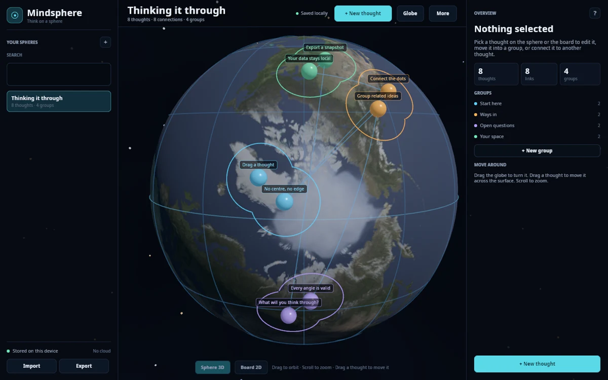

# Mindsphere

A local-first sphere mind mapper built with **Rust and Bevy 0.20**. Every thought gets a place on a globe; turn the sphere, group related ideas, and draw paths between them. A flat board view shows the same map as columns.

**Try it in the browser:** <https://orbitmechanic.github.io/mindsphere/>



Mindsphere has no account system, no cloud dependency, and no telemetry. Spheres are plain JSON on your device.

## What it does

- **3D sphere view** — orbit, zoom, drag thoughts across the surface, and follow connection paths.
- **Hex-packed groups** — thoughts in a group occupy a tight hexagonal lattice, and each group's edge is the union of per-thought radii, forming an amorphous coloured outline.
- **Force layout** — groups attract to their local centroid and group boundaries repel each other. Links carry no force, so connections never distort the layout.
- **Projection lines** — switch the globe overlay between latitude/longitude, a geodesic hexagon/pentagon pattern, or off.
- **2D board view** — groups become columns, with notes and connections visible at a glance. Drag column headers to reorder groups and drag cards to reorder thoughts or move them across groups.
- **Thought inspector** — edit titles and notes, move thoughts between groups, and create connections.
- **Globe controls** — a right-side panel covers the overview while you adjust radius, transparency, surface, backdrop, projection lines, and each group's edge colour in real time.
- **Selection and linking** — Ctrl/Shift-click or the **Multi** button selects several thoughts. **Add to group** and **Remove from group** replace the new-thought button while multiple thoughts are selected. Link mode chains clicks into links; **Erase link** starts an unlink mode that highlights the linked thoughts.
- **Two-line console** — every mode reports the next action at the bottom of the screen.
- **Local library** — create, rename, duplicate, delete, import, and export spheres.
- **Autosave** — changes are written locally after a short idle delay.
- **No lock-in** — exported JSON is readable, portable, and easy to back up.

## Run it

Requires Rust 1.97 or newer.

```sh
cargo run
```

On first launch, Mindsphere creates a small demo sphere called “Thinking it through.” Native builds also migrate spheres from the old Godot version when it finds them.

### Build the web version

```sh
rustup target add wasm32-unknown-unknown
cargo install wasm-bindgen-cli --version 0.2.129 --locked
./tools/build_web.sh build/web
python3 -m http.server 8765 --directory build/web
```

The build script uses `wasm-opt` when it is installed and stages only the runtime assets. The GitHub Actions workflow does the same for Pages.

## Controls

| Action | Control |
| --- | --- |
| Orbit the sphere | Drag the background |
| Zoom | Scroll |
| Move a thought | Drag it across the sphere |
| Edit a thought | Select it, then use the inspector |
| New thought | `N` or the button in the top bar |
| Multi-select | **Multi** button, or `Ctrl` / `Shift` + click |
| Link mode | **Link** button or `L`; click thoughts in order |
| Erase links | **Erase link** in the thought inspector |
| Globe settings | **Globe** button in the top bar |
| Reorder groups | Drag a board column header |
| Reorder / move thoughts | Drag a board card |
| Switch sphere / board | `1` / `2` |
| Search spheres | `Ctrl+F` |
| Export sphere | `Ctrl+E` |
| Save now | `Ctrl+S` |
| Delete selected thought | `Delete` or `Backspace` |
| Clear selection / close dialog | `Esc` |

## Your data

Native builds keep the library in the platform data directory:

- **Linux:** `~/.local/share/mindsphere/library.json`
- **macOS:** `~/Library/Application Support/mindsphere/library.json`
- **Windows:** `%APPDATA%\mindsphere\library.json`

Settings live beside it in `settings.json`. Use **Export as JSON** for a portable copy.

In the browser build, the library lives in `localStorage` under `mindsphere.library.v1`. Clearing site data removes it, so export anything you want to keep. The web Import button opens a native file picker; you can also paste JSON through the Import dialog on desktop.

## Architecture

Mindsphere is an ECS application, not a scene-tree app with a database bolted on:

- `src/model.rs` — serializable sphere, thought, group, and link records plus normalization.
- `src/state.rs` — the app resource and action vocabulary shared by every system.
- `src/scene.rs` — globe, thought meshes, labels, group outlines, orbit camera, picking, and dragging.
- `src/forces.rs` — hex packing, group-boundary repulsion, and force settling.
- `src/skins.rs` — planet, exoplanet, pattern, colour, gradient, and star-map skin catalog.
- `src/ui.rs` — Bevy UI panels, right-side globe controls, board drag/drop, inspector, sliders, link/selection modes, console, dialogs, and text inputs.
- `src/storage.rs` — native files, browser `localStorage`, migration, import/export.
- `src/actions.rs` — action dispatch, shortcuts, web import polling, and drag/drop.

All UI and 3D objects are driven by the same entity/resource model, so switching views does not copy or reserialize the map.

## Tests

```sh
cargo fmt --check
cargo clippy --all-targets -- -D warnings
cargo test
```

The model tests cover welcome data, link cleanup, duplication, and JSON round-trips.

Planet surface textures are from [Solar System Scope](https://www.solarsystemscope.com/textures/) under CC BY 4.0; see `assets/textures/LICENSE.txt`.

## License

MIT. See [LICENSE](LICENSE).
